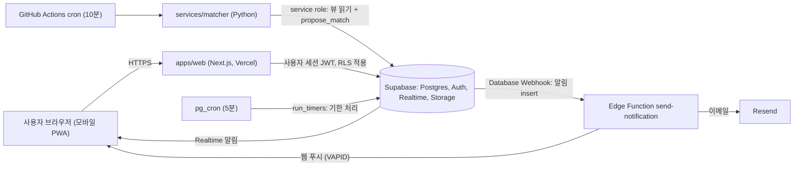

# 구양이 아키텍처

웹 / 매칭 워커 / Supabase 의 경계, 데이터 흐름, DB 스키마, RLS 정책 개요.
요구사항은 [specs/PRD.md](specs/PRD.md), 결정 근거는 [adr/](adr/README.md), 그림은 [diagrams/](diagrams/) 참고.
이 문서는 설계 기준이다. 실제 DDL은 Sprint 2에서 `supabase/migrations` 에 쓴다.

## 1. 구성 요소와 경계



| 구성 요소 | 하는 일 | 하지 않는 일 |
|---|---|---|
| **apps/web** | 화면, 입력 검증(zod), 사용자 세션으로 Supabase 호출 | service role 키 보유, 매칭 계산, 상태 전이 규칙 판단 |
| **Supabase (Postgres)** | 데이터 저장, RLS, 불변 조건(제약·함수), 상태 전이, 기한 처리, 인증, 알림 전달 | 매칭 후보 탐색 |
| **services/matcher** | 양/구 그래프에서 1:1·3자 순환 후보를 찾아 제안 | 테이블 직접 쓰기, 수락·발송·완료 처리 |
| **Edge Function `send-notification`** | 알림 행을 받아 웹 푸시와 이메일(Resend) 발송, 결과 기록 | 알림을 만들지 않는다 (알림 행은 DB 함수가 만든다) |

경계 규칙:
1. **불변 조건은 DB가 지킨다.** 수량, 예약, 상태 전이는 제약과 `security definer` 함수 안에서만 바뀐다. 웹과 매처는 함수를 부를 뿐이다.
2. **매처는 제안만 한다.** 뷰 3개를 읽고 `propose_match` 하나만 호출한다. 매처가 본 데이터가 그사이 바뀌었으면 함수가 거부하고, 매처는 그 후보를 버린다.
3. **service role 키는 매처(GitHub Actions secret)와 Supabase 안의 Edge Function 에만 있다.** 웹(Vercel)에는 두지 않는다. 웹은 관리자 기능도 사용자 세션 + RLS(`is_admin()`)로 처리한다. Resend API 키와 VAPID 비밀 키도 Edge Function secret 으로 둔다.
4. **매칭과 무관한 기한 처리는 DB 안에서 돈다** (pg_cron). 매처 cron이 늦거나 멈춰도 만료·분쟁 전환·배송 정보 삭제는 계속된다.

## 2. 데이터 흐름

### 2.0 가입
프로필은 **동의한 뒤에만** 만들어진다. `profiles` 의 확인·동의 컬럼이 모두 `not null` 이라, 동의 없이 만들어진 프로필은 존재할 수 없다.

1. 카카오·구글 로그인 → `auth.users` 행만 생긴다. 이 시점에는 프로필이 없다. (가입 트리거로 프로필을 자동 생성하지 않는다.)
2. 프로필이 없는 로그인 사용자는 가입 화면으로만 갈 수 있다. 다른 화면은 가입 화면으로 돌려보낸다.
3. 가입 화면에서 닉네임, 만 14세 이상 확인(필수), 이용약관 동의(필수), 개인정보 처리방침 동의(필수)를 받는다.
4. `create_profile(nickname, terms_version, privacy_version)` 호출. 함수가 한 트랜잭션에서 `profiles`, `user_stats`, `notification_settings` 를 만든다. 확인·동의 시각은 클라이언트 값이 아니라 함수 안의 `now()` 로 찍는다. 버전이 현재 문서 버전과 다르면 거부한다.
5. 문서가 바뀌면 현재 버전(`app_settings` 의 `terms_version`, `privacy_version`)과 프로필의 버전이 달라진다. 이런 사용자는 다시 동의 화면을 거치고, `agree_terms(terms_version, privacy_version)` 이 시각과 버전을 갱신한다.

구현은 Sprint 2 (2.1, 2.6), 약관·처리방침 문서와 동의 화면의 실제 문안은 Sprint 3 (3.14).

### 2.1 도감 입력
1. 사용자가 세트를 도감에 추가 → `collection_sets` insert. 교환 참여 스위치는 꺼진 채로 만들어진다.
2. 아이템별 보유 수량 입력 → `collection_entries` insert 또는 update (RLS: 본인 행만, `reserved_qty` 는 쓸 수 없음. `upsert()` 는 쓸 수 없다, 3.3. 수량을 올리고 내리는 것은 Sprint 3 의 DB 함수로 한다). 여기까지는 기록일 뿐이고 양에도 구에도 잡히지 않는다.
3. 사용자가 세트의 "교환 시작" 을 누르고 구의 범위(빈칸 전부 / 고른 것만)를 고른다 → `collection_sets.trade_enabled = true`, `want_mode`. 기본은 종류마다 하나 소장이다.
4. 필요한 칸만 예외를 둔다: 이 칸은 내놓지 않음, 이 칸의 소장 개수 변경.
5. 양은 `tradable_haves` 뷰, 구는 `wanted_items` 뷰가 계산한다. 따로 저장하지 않는다 (3.3).

### 2.2 매칭 제안 (10분마다)
1. 매처가 `tradable_haves`, `wanted_items`, `matchable_users` 를 읽는다.
2. "u가 가진 것을 v가 원한다" 를 간선 u→v 로 하는 그래프를 만들고 길이 2(pair), 길이 3(cycle3) 순환을 찾는다.
3. 2단계로 고른다: 먼저 1:1 을 전부 선택하고, 남은 수량과 사용자로 3자 순환을 선택한다. 각 단계 안의 순서는 재매칭 우선권 → 구 우선순위 → 대기 시간 → ID 순 (자세한 규칙은 [matcher.md](matcher.md)). 최근 7일 안에 거절·만료된 매칭에 있던 **같은 leg 조합**(보내는 사람, 받는 사람, 아이템)은 뺀다. 같은 두 사람이라도 아이템이 다르면 다시 제안할 수 있다.
4. 후보마다 `propose_match(kind, legs)` 호출. 함수가 한 트랜잭션에서:
   - 관련 `collection_entries` 행을 `(user_id, item_id)` 순서로 잠그고 양 수량을 다시 확인
   - cycle3 이면 참여자 자격 확인
   - `matches`, `match_participants`, `match_legs` insert, `reserved_qty` 증가, `respond_by` 설정
   - 참여자에게 알림 insert
5. 알림은 Realtime 으로 열려 있는 화면에 전달된다.

### 2.3 수락 → 성사
1. 참여자가 `accept_match(match_id, 배송 정보)` 호출. 수락과 함께 받을 주소를 입력한다 (보관 정책은 ADR-0004).
2. 한 명이라도 `decline_match` → `cancelled`, 예약 해제, 입력된 배송 정보 즉시 삭제.
3. 전원 수락 → `confirmed`, `ship_by` 설정. 이때부터 보내는 사람이 받는 사람의 배송 정보를 볼 수 있다.

### 2.4 발송 → 완료
1. 보내는 사람이 `mark_shipped(leg_id, carrier, tracking_no)` → 첫 발송에서 `shipping`.
2. 받는 사람이 `mark_received(leg_id)`.
3. 모든 leg 가 수령되면 같은 트랜잭션에서 `completed`:
   - 보낸 사람: `owned_qty - 1`, `reserved_qty - 1`
   - 받은 사람: `owned_qty + 1`. `keep_qty` 가 null(기본, 하나 소장)이면 그대로 두고, 숫자면 `greatest(keep_qty, 1)` 로 올린다 (받자마자 다시 양으로 나가지 않게)
   - 참여자 전원 `completed_count + 1`, 배송 정보 삭제 예정 시각 기록

도감 반영은 leg 단위 동작이다 (`match_legs.settled_at` 으로 한 번만 실행되게 한다). 정상 완료에서는 모든 leg 가 한 트랜잭션에서 함께 반영된다.

**자동 수령 확인**: 발송 표시 후 7일 동안 수령 확인도 미수령 신고도 없으면 `run_timers()` 가 그 leg 를 수령 처리한다 (`auto_received = true`). 받는 사람이 확인을 잊어서 교환이 끝나지 않는 일을 막는다. 미수령 신고가 접수된 leg 는 자동 수령하지 않고 운영자 판단을 기다린다.

### 2.4.1 분쟁 후 취소 (부분 발송)
`disputed` 에서 못 받은 참여자가 `cancel_disputed_match` 를 부르면 leg 를 세 가지로 나눠 처리한다.

| leg 상태 | 처리 |
|---|---|
| 수령 확인됨 | 즉시 도감에 반영 |
| 발송했지만 수령 확인 전 | **예약 유지.** 이후 수령 확인 또는 자동 수령 확인 때 도감에 반영 |
| 미발송 | 예약 해제 |

- 매칭은 `cancelled` 가 되지만, 발송된 leg 의 `mark_received` 와 자동 수령은 그 뒤에도 동작한다.
- **피해자**(자기 것은 보냈는데 받을 것은 미발송): `priority_since` 설정(재매칭 우선권) + 못 받은 아이템을 `wants` 최상위 우선순위로 올린다 (그 사용자의 최고 priority + 1).
- **미발송자**(72시간 넘게 발송 표시가 없던 leg 의 보내는 사람): 미발송 신고 횟수 **자동 +1**. 시스템이 `reports` 에 확인된 미발송 신고를 한 줄 남긴다 (`source = system`). 그 외의 신고는 운영자가 확인한 것만 센다.
- **이의 제기**: 자동 +1 을 받은 당사자는 그 신고에 이의를 제기할 수 있다 (송장 입력만 빠뜨린 경우 등). `reports` 에 `reason = appeal`, `appeal_of = 원래 신고` 로 남긴다. 운영자가 받아들이면 원래 신고를 기각으로 바꾸고 횟수를 −1 하며 정지 여부를 다시 계산한다. 운영자는 이의 제기가 없어도 직접 정정할 수 있다.
- 누적 기준은 `app_settings`: 1회 = cycle3 불가(`cycle3_max_reports`), 2회 = 신규 매칭 정지(`suspend_report_count`).

### 2.5 기한 처리 (pg_cron 5분)
| 조건 | 처리 |
|---|---|
| `proposed` 이고 `respond_by` 지남 | `expired`, 예약 해제, 배송 정보 삭제, 무응답자 `no_response_count + 1`, 나머지 참여자에게 재매칭 우선권 |
| `confirmed`/`shipping` 이고 발송 안 한 leg 가 48h 지남 | 보내는 사람에게 경고 알림 (1회) |
| 같은 조건으로 72h 지남 | `disputed`, 전원에게 알림. 못 받은 사람이 취소를 선택할 수 있다 |
| 발송된 leg 가 7일 동안 수령 확인도 미수령 신고도 없음 | 자동 수령 처리. 전부 수령되면 `completed`, 취소된 매칭이면 그 leg 만 도감 반영 |
| 종료(`completed`/`cancelled`) 후 30일 지남, 반영 안 된 발송 leg 없음 | 배송 정보와 송장 정보 삭제 |
| 알림이 5분 넘게 미발송, 시도 3회 미만 | `send-notification` 재호출 |

시간 값은 모두 `app_settings` 에서 읽는다.

### 2.6 알림 전달
알림 행은 DB 함수(`propose_match`, `run_timers` 등)가 `notifications` 에 넣는다. 전달은 세 채널이다.

| 채널 | 방법 | 대상 알림 |
|---|---|---|
| 인앱 | Realtime 구독 + 알림 목록 | 전부 |
| 웹 푸시 | VAPID, `push_subscriptions` 의 모든 기기 | 전부 |
| 이메일 | Resend | **기한이 걸린 알림만**: 수락 요청, 발송 기한 경고, 분쟁 전환 |

흐름:
1. `notifications` insert → Database Webhook → Edge Function `send-notification`.
2. 함수가 수신자의 `push_subscriptions` 와 `notification_settings` 를 읽어 푸시를 보내고, 알림 종류가 기한 알림이면 이메일도 보낸다.
3. 결과를 `push_sent_at`, `email_sent_at`, `delivery_attempts` 에 기록한다. 푸시 서버가 404/410 을 돌려준 구독은 삭제한다.
4. 실패한 알림은 `run_timers()` 가 최대 3회까지 다시 보낸다.

이메일 규칙:
- 본문에 배송 정보·주소·상대 닉네임 외 개인정보를 넣지 않는다. "무슨 일이 생겼는지 + 기한 + 바로가기 링크" 만 담는다.
- 발신 도메인은 Resend 에 DNS 인증한 자체 도메인을 쓴다 (출시 전 작업).

로그인 제공자에서 이메일을 못 받는 경우:
- 구글은 인증된 이메일을 준다 → 가입 시 `notification_settings.email` 에 복사하고 인증된 것으로 표시.
- 카카오는 이메일이 선택 동의 항목이고 앱 설정에 따라 아예 못 받을 수 있다 → Supabase 카카오 제공자에서 이메일 없는 사용자를 허용하고(Sprint 2 에서 설정 확인), 가입 후 **알림용 이메일을 직접 입력**받는다. Resend 로 확인 링크를 보내 인증한 뒤에만 이메일 채널을 켠다.
- 이메일 입력을 건너뛸 수 있다. 이때 기한 알림은 푸시로만 간다.
- 푸시 구독도 인증된 이메일도 없는 사용자는 수락 화면에서 "기한 알림을 받을 방법이 없어요" 경고를 본다.

홈 화면 추가 안내:
- iOS 는 홈 화면에 추가한 PWA 에서만 웹 푸시가 온다 (iOS 16.4 이상).
- **첫 매칭을 수락하기 전에** "홈 화면에 추가하고 알림 켜기" 안내를 보여 준다. 알림 권한 요청은 이 안내에서 사용자가 버튼을 눌렀을 때만 띄운다.

## 3. DB 스키마

규칙 (ecc:postgres-patterns): PK 는 `bigint generated always as identity` (사용자 id 만 Supabase Auth 의 `uuid`), 문자열은 `text`, 시각은 `timestamptz`, 모든 FK 에 인덱스, RLS 정책의 `auth.uid()` 는 `(select auth.uid())` 로 감싼다.

### 3.1 사용자
| 테이블 | 주요 컬럼 | 비고 |
|---|---|---|
| `profiles` | `id uuid PK → auth.users`, `nickname text`(2~12자, 한글 완성형·영문·숫자·밑줄, `lower(nickname)` 에 unique), `age_confirmed_at timestamptz not null`, `terms_agreed_at timestamptz not null`, `terms_version text not null`, `privacy_agreed_at timestamptz not null`, `privacy_version text not null`, `created_at` | 만 14세 이상 확인 시각, 이용약관·개인정보 처리방침에 동의한 시각과 그때의 문서 버전. 사용자가 직접 고칠 수 있는 것은 `nickname` 뿐이다 (컬럼 권한). 문서가 바뀌어 다시 동의받으면 시각과 버전을 갱신한다 |
| `user_stats` | `user_id uuid PK → profiles`, `completed_count int`, `confirmed_report_count int`, `no_response_count int`, `priority_since timestamptz`, `suspended_at timestamptz` | 최소 평판. **함수만 쓴다.** `priority_since` = 재매칭 우선권, 다음 제안을 받으면 비운다. 다른 사용자에게는 횟수 3개만 보이고, `suspended_at` 과 `priority_since` 는 `user_status(user_id)` 함수로 본인과 운영자만 읽는다 |
| `admins` | `user_id uuid PK → profiles` | 클라이언트 접근 없음. `is_admin()` 함수로만 확인 |

- `confirmed_report_count` 는 확인된 미발송 신고만 센다: 운영자가 확인한 신고 + 분쟁 후 취소에서 자동 기록된 미발송.
- 1회 이상이면 cycle3 불가, 2회 이상이면 `suspended_at` 이 찍혀 매칭 대상에서 빠진다(해제는 운영자). 기준 횟수는 `app_settings`.
- 닉네임은 영문 대소문자를 구분하지 않고 중복을 막는다 (`Cat` 과 `cat` 은 같은 닉네임). 사칭할 수 있는 이름(운영자, 관리자, admin, 구양이 등)은 `create_profile` 과 닉네임 변경에서 막는다 (TASKS 2.6).
- 탈퇴하면 `auth.users` → `profiles` → `user_stats`·도감이 함께 지워진다 (`on delete cascade`). 진행 중인 교환이 있는 사용자의 탈퇴 처리와, 탈퇴 후에도 상대방에게 교환 기록이 남게 하는 방법은 Sprint 5 에서 정한다 (TASKS 5.1).
- **컬럼 권한**: 테이블마다 `anon`·`authenticated` 의 기본 권한을 전부 회수하고 필요한 컬럼만 준다. 그래서 클라이언트의 `select('*')` 는 권한 오류(42501)가 난다. 웹 코드는 항상 컬럼을 명시한다.

### 3.2 카탈로그 (장르 독립)
| 테이블 | 주요 컬럼 | 비고 |
|---|---|---|
| `series` | `id`, `name text unique`, `slug text unique` | 장르/작품. 시드: 프로세카 |
| `sets` | `id`, `series_id FK`, `name`, `kind text check (collab_cafe, fair_bonus, theater_bonus, kuji, can_badge, other)`, `released_on date`, `is_published boolean`, `image_path`, `cell_ratio text not null default '1:1' check (1:1, 3:4)` | 랜덤 굿즈 묶음. `kind`: `fair_bonus` = 페어(fair, 기획전) 특전, `theater_bonus` = 극장 관람 특전. `cell_ratio` = 도감 칸의 가로:세로 비율 (`1:1` 원형·정사각형 굿즈, `3:4` 카드형). 값의 뜻은 DESIGN.md |
| `items` | `id`, `set_id FK`, `name`, `sort_order int`, `image_path`, `unique (set_id, sort_order)` | 세트의 한 종류. 이미지는 운영자가 촬영한 실물 사진, 없으면 기본 실루엣 |
| `set_requests` | `id`, `user_id FK`, `title`, `detail`, `source_url`, `status text check (pending, accepted, rejected)`, `handled_at` | 세트 추가 요청 |

### 3.3 도감
도감에 기록하는 것과 교환에 내놓는 것은 다른 일이다. **기록만 한 사용자의 아이템은 양에도 구에도 잡히지 않는다.** 교환 참여는 세트 단위 스위치로 켠다 (기본 꺼짐).

| 테이블 | 주요 컬럼 | 비고 |
|---|---|---|
| `collection_sets` | `PK (user_id, set_id)`, `trade_enabled boolean not null default false`, `want_mode text not null default 'all_missing' check (all_missing, selected)`, `added_at`, `trade_enabled_at timestamptz`(null 허용), `check (trade_enabled = (trade_enabled_at is not null))` | 도감에 추가한 세트. `trade_enabled` = **세트의 교환 참여 스위치**. 꺼져 있으면 그 세트의 아이템은 양에도 구에도 없다. `want_mode` = 구의 범위 (아래). `trade_enabled_at` = **스위치를 켠 시각**, 대기 시간의 하한 (아래) |
| `collection_entries` | `PK (user_id, item_id)`, `owned_qty int not null default 0`, `keep_qty int`(null 허용), `trade_enabled boolean not null default true`, `reserved_qty int not null default 0`, `updated_at` | 칸 하나. `keep_qty` 가 null 이면 **기본(종류마다 하나 소장)**, 숫자면 이 칸만 바꾼 소장 개수. `trade_enabled = false` 는 "이 칸은 내놓지 않음" (양에만 작용한다) |
| `wants` | `PK (user_id, item_id)`, `priority smallint not null default 0`, `created_at timestamptz not null default now()` | `want_mode = 'all_missing'` 에서는 구의 우선순위만 담는다. `'selected'` 에서는 **행이 있는 아이템만 구**이고 `priority` 는 그 안의 우선순위다. `created_at` = 고른 시각 (`selected` 에서 대기 시간의 기준) |

**실제 소장 개수** = `coalesce(keep_qty, least(owned_qty, 1))`. 하나뿐인 굿즈는 기본으로 양에 잡히지 않고, 보유가 0→2 로 늘면 저절로 하나만 소장한다. 기본값을 `keep_qty = 1` 로 저장하지 않는 이유는 보유 0 인 칸에서 `keep_qty <= owned_qty` 를 어기기 때문이다.

`collection_entries` 제약:
```sql
check (owned_qty >= 0 and reserved_qty >= 0),
check (keep_qty is null or (keep_qty >= 0 and keep_qty <= owned_qty)),
check (owned_qty - coalesce(keep_qty, least(owned_qty, 1)) - reserved_qty >= 0)
```
- 예약 중인 수량 아래로 보유 수량을 줄이거나 소장 개수를 올리는 수정은 마지막 제약이 막는다.
- 칸별 설정은 예외용이다: "이 칸은 내놓지 않음"(`trade_enabled = false`), "이 칸의 소장 개수 변경"(`keep_qty` 에 숫자). `keep_qty` 를 null 로 되돌리면 기본으로 돌아간다.

**구의 범위 (`want_mode`)**: 세트 스위치를 켤 때 화면에서 둘 중 하나를 고른다 (기본 선택은 `all_missing`).

| 값 | 구 | `wants` 의 역할 |
|---|---|---|
| `all_missing` (빈칸 전부 구하기) | 그 세트에서 보유 0 인 아이템 전부 | 우선순위 지정만 |
| `selected` (고른 것만 구하기) | `wants` 에 있는 아이템 중 보유 0 인 것만. 고르지 않은 빈칸은 구가 아니다 | 구할 아이템을 고르는 목록 + 우선순위 |

**세트 스위치를 끌 때**: 그 세트의 아이템은 양·구에서 바로 빠져 새 매칭에 잡히지 않는다. 이미 제안된 매칭과 그 예약(`reserved_qty`)은 그대로 진행한다. `propose_match` 는 수량을 다시 확인할 때 아래 뷰와 같은 조건(세트 스위치 포함)을 쓴다.

**스위치를 켠 시각 (`trade_enabled_at`)**: 트리거가 기록한다. 꺼짐 → 켜짐일 때(켠 채로 추가하는 것 포함) `now()`, 끄면 null, 켜 둔 채 다른 값을 고치면 그대로다. 넘어온 값은 버리므로 사용자도 service role 도 직접 쓸 수 없다. 뷰 `wanted_items` 의 `waiting_since` 는 이 시각보다 앞서지 않는다. 세트를 도감에 넣기 전에도 `wants` 와 칸을 만들 수 있고 세트를 추가만 해 두고 한참 뒤에 켤 수도 있어서, 하한이 없으면 미리 만들어 둔 행으로 매칭 순서를 당길 수 있다 (2.3 보안 검토 M1). 껐다 켜면 대기 시간은 새로 시작한다. 양(`tradable_haves`)에는 대기 시간 컬럼이 없다.

**세트를 도감에서 뺄 때** (`collection_sets` 행 삭제, `before delete` 트리거 `collection_sets_remove_entries`):
- 그 세트의 칸 중 `reserved_qty > 0` 인 것이 있으면 거부한다 (`23001`). 스위치를 끄는 것은 예약이 있어도 되지만, 행을 지우면 진행 중인 교환의 칸이 뷰와 화면에서 사라지기 때문이다 (2.3 보안 검토 L1).
- 거부되지 않으면 그 세트의 `collection_entries` 와 `wants` 를 함께 지운다. 화면에서는 지우기 전에 확인을 받는다 (TASKS 3.4).
- 트리거 함수는 `security definer` 다. 운영자가 비공개로 돌린 세트는 사용자가 `items` 를 읽지 못해서, 호출자 권한으로는 어느 칸이 그 세트의 것인지 알 수 없다. 지우는 범위는 지워지는 행의 `user_id`, `set_id` 로 고정이다.
- 확인하기 전에 그 칸들을 `item_id` 오름차순으로 잠근다 (`for update`). `propose_match` 도 같은 순서로 잠가야 교착이 나지 않는다. `propose_match`(Sprint 4)도 예약을 올리기 전에 같은 칸을 잠그므로 확인과 삭제 사이에 예약이 끼어들지 못한다.
- 계정 삭제(`profiles` 삭제의 연쇄)에서도 이 트리거가 불린다. **예약이 남아 있는 사용자의 계정 삭제는 거부된다.** 탈퇴 흐름은 진행 중인 교환을 먼저 정리해야 한다 (탈퇴를 만드는 스프린트에서 다룬다).

권한 (RLS 는 본인 행만, 4장):
- `collection_sets`: insert·delete, update 는 `trade_enabled`, `want_mode` 만. `added_at`, `trade_enabled_at` 은 쓸 수 없다. delete 는 위 트리거를 거친다.
- `collection_entries`: insert·update 는 `owned_qty`, `keep_qty`, `trade_enabled` 만 (insert 는 키 컬럼 포함). **`reserved_qty` 는 insert 로도 update 로도 쓸 수 없고 함수만 바꾼다.** delete 는 `reserved_qty = 0` 인 행만.
- `wants`: insert·update(`priority`)·delete. `created_at` 은 사용자가 쓸 수 없다 (기본값으로만 들어간다).
- insert 정책은 `user_id = (select auth.uid())` 에 더해 **호출자가 읽을 수 있는 세트·아이템인지**(`exists (select 1 from sets ...)`, `exists (select 1 from items ...)`) 확인한다. 정책 검사는 FK 검사보다 먼저 되므로, 비공개 세트의 id 를 넣어 보고 FK 오류(23503) 여부로 존재를 알아내는 길이 막힌다 (2.2 보안 검토 정보성 3).
- **`upsert()` 는 쓸 수 없다.** supabase-js 의 upsert 는 충돌 시 키 컬럼(`user_id`, `item_id`)까지 다시 쓰는데 그 컬럼에는 update 권한이 없어 42501 로 거부된다. 웹은 insert 와 update 를 나눠 부른다 (2.3 구현에서 확인). 칸 수량을 올리고 내리는 것은 읽고-더하고-쓰기로 하면 빠른 연타에서 숫자가 꼬이므로, Sprint 3 (TASKS 3.6) 에서 원자적으로 더하고 빼는 DB 함수를 만든다 (테스트 C10).
- identity 시퀀스가 생기면 `anon`, `authenticated` 권한을 회수한다 (2.2 와 같은 규칙. 위 세 테이블은 identity 컬럼이 없다).

뷰 (`security_invoker = true`). **두 뷰 모두 Sprint 2 (TASKS 2.3) 에서 만든다.** "스위치가 꺼진 세트는 양·구에 없다" 를 스키마와 테스트로 먼저 고정하기 위해서다.
```sql
-- 양: 세트 스위치가 켜져 있고, 칸을 내놓았고, 실제 소장과 예약을 빼고 남는 것
create view tradable_haves as
select e.user_id, e.item_id,
       e.owned_qty - coalesce(e.keep_qty, least(e.owned_qty, 1)) - e.reserved_qty as qty
from collection_entries e
join items i on i.id = e.item_id
join sets s on s.id = i.set_id and s.is_published
join collection_sets cs on cs.user_id = e.user_id and cs.set_id = i.set_id
where cs.trade_enabled
  and e.trade_enabled
  and e.owned_qty - coalesce(e.keep_qty, least(e.owned_qty, 1)) - e.reserved_qty > 0;

-- 구: 세트 스위치가 켜져 있고, 보유 0 이고, (빈칸 전부 구하기 이거나 wants 에 고른 것)
create view wanted_items as
select cs.user_id, i.id as item_id, i.set_id,
       coalesce(w.priority, 0) as priority,
       -- 대기 시간 기준: 고른 것만 구하기는 고른 시각, 빈칸 전부 구하기는 칸 수정 시각(없으면 세트 추가 시각).
       -- 어느 쪽이든 스위치를 켠 시각보다 앞서지 않는다
       greatest(case when cs.want_mode = 'selected' then w.created_at
                     else coalesce(e.updated_at, cs.added_at) end,
                cs.trade_enabled_at) as waiting_since
from collection_sets cs
join sets s on s.id = cs.set_id and s.is_published
join items i on i.set_id = cs.set_id
left join collection_entries e on e.user_id = cs.user_id and e.item_id = i.id
left join wants w on w.user_id = cs.user_id and w.item_id = i.id
where cs.trade_enabled
  and coalesce(e.owned_qty, 0) = 0
  and (cs.want_mode = 'all_missing' or w.item_id is not null);
```
- 세트를 도감에서 빼면(`collection_sets` 행 삭제) 그 세트의 칸과 구 목록도 함께 지워진다 (위 "세트를 도감에서 뺄 때"). 세트를 넣기 전에 만들어 둔 칸처럼 `collection_sets` 행이 없는 칸은 양에 잡히지 않는다 (inner join).
- `s.is_published` 를 뷰에 직접 쓴다. 사용자 세션은 RLS 로 비공개 세트가 원래 안 보이지만, 매처(service role)는 RLS 를 건너뛰므로 조건이 뷰에 있어야 두 경로의 결과가 같다. 운영자가 비공개로 돌린 세트는 양·구에서 빠진다.
- **Sprint 4 (TASKS 4.2) 에서 더하는 것**: `wanted_items` 에 "이미 받기로 한 것 제외" 조건 (테스트 P11).
  ```sql
  and not exists (
    select 1 from match_legs l join matches m on m.id = l.match_id
    where l.to_user = cs.user_id and l.item_id = i.id
      and (m.status in ('proposed', 'confirmed', 'shipping', 'disputed')
           -- 취소된 매칭이라도 이미 발송되어 오는 중인 것
           or (l.shipped_at is not null and l.settled_at is null and l.released_at is null)))
  ```
- **정지된 사용자**: 양·구 뷰에는 정지 여부를 넣지 않는다. 사용자는 `user_stats.suspended_at` 을 읽을 권한이 없어서(3.1) `security_invoker` 뷰에 넣으면 사용자 세션에서 권한 오류가 난다. **매처가 `matchable_users` 와 join 해서 거른다** (TASKS 4.2, 4.12). 뷰가 막아 주지 않으므로 빠뜨리면 정지된 사용자에게 제안이 간다. 테스트 M22 와 P13 이 이것을 지킨다.

`matchable_users` 뷰 (Sprint 4): 정지되지 않은 사용자의 `user_id`, `can_cycle3`(완료 3회 이상 and 확인된 신고 0회), `priority_since`.

### 3.4 매칭과 교환
| 테이블 | 주요 컬럼 | 비고 |
|---|---|---|
| `matches` | `id`, `kind text check (pair, cycle3)`, `status text check (proposed, confirmed, shipping, completed, cancelled, expired, disputed)`, `respond_by`, `confirmed_at`, `ship_by`, `warned_at`, `closed_at`, `cancel_reason text`, `created_at` | 상태 전이는 [diagrams/exchange-state-machine.md](diagrams/exchange-state-machine.md) |
| `match_participants` | `PK (match_id, user_id)`, `response text check (pending, accepted, declined)`, `responded_at` | 수락 여부 |
| `match_legs` | `id`, `match_id FK`, `from_user FK`, `to_user FK`, `item_id FK`, `carrier text`, `tracking_no text`, `shipped_at`, `received_at`, `auto_received boolean`, `settled_at`, `released_at`, `check (from_user <> to_user)` | **한 줄 = 아이템 하나.** `(match_id, from_user, to_user)` 에 unique 를 두지 않는다 (묶음 교환 확장용) |
| `shipping_addresses` | `PK (match_id, user_id)`, `recipient_name`, `phone`, `postal_code`, `address1`, `address2`, `created_at` | `user_id` = 받는 사람. 매칭 단위로만 저장 |
| `reports` | `id`, `match_id FK`, `leg_id FK null`, `reporter_id FK`, `reported_id FK`, `reason text check (not_shipped, not_received, appeal, other)`, `source text check (user, system)`, `appeal_of FK null → reports`, `detail`, `status text check (pending, confirmed, dismissed)`, `handled_by`, `handled_at`, `unique (match_id, reporter_id, reported_id, reason)` | 미발송·미수령 신고, 자동 기록, 이의 제기 |

- `source = system` 인 행은 분쟁 후 취소 때 자동으로 생기는 확인된 미발송 신고다 (`reporter_id` 없음).
- 이의 제기는 같은 테이블을 쓴다: 신고받은 본인이 `reason = appeal` 로 접수하고 `appeal_of` 로 원래 신고를 가리킨다.

- leg 의 끝은 둘 중 하나다: `settled_at`(도감에 반영됨) 또는 `released_at`(예약만 풀림). 둘 다 비어 있으면 예약이 살아 있다.
- 미수령 신고(`not_received`)는 "발송 표시는 됐는데 오지 않았다" 는 신고다. 접수되면 그 leg 의 자동 수령이 멈춘다. 운영자가 확인하면 leg 를 미발송으로 보고 예약을 풀며 미발송 신고 횟수에 넣고, 기각하면 수령 처리한다.

- MVP 에서는 발송 정보(`carrier`, `tracking_no`)를 leg 에 둔다. 묶음 교환을 열 때 `shipments` 테이블로 분리한다.
- "사이클에 같은 사용자 중복 금지", "수량 초과 금지" 는 `propose_match` 가 확인하고, 매처의 pytest 와 DB 테스트 양쪽에서 검증한다.

### 3.5 운영
| 테이블 | 주요 컬럼 | 비고 |
|---|---|---|
| `notifications` | `id`, `user_id FK`, `type text`, `match_id FK null`, `payload jsonb`, `needs_email boolean`, `push_sent_at`, `email_sent_at`, `delivery_attempts int`, `read_at`, `created_at` | Realtime 구독 대상. `needs_email` = 기한 알림 |
| `push_subscriptions` | `id`, `user_id FK`, `endpoint text unique`, `p256dh text`, `auth text`, `user_agent text`, `created_at` | 기기별 웹 푸시 구독. 만료되면 삭제 |
| `notification_settings` | `user_id uuid PK → profiles`, `email text`, `email_verified_at`, `email_enabled boolean`, `push_enabled boolean` | 알림용 이메일. 이메일은 비공개라 `profiles` 에 두지 않는다 |
| `app_settings` | `key text PK`, `value jsonb`, `description`, `is_public boolean`, `updated_at` | 아래 표. `is_public` 인 키만 로그인 사용자가 읽는다. 키 추가와 공개 여부는 마이그레이션으로만 바꾼다 |
| `matcher_runs` | `id`, `started_at`, `finished_at`, `proposed_pair int`, `proposed_cycle3 int`, `rejected int`, `blocked_cycle3 int`, `capped_sets jsonb`, `error text` | 매처 실행 기록. `blocked_cycle3` = 1:1 때문에 성립하지 못한 3자 순환 후보 수, `capped_sets` = 후보 상한에 걸린 세트 |

`app_settings` 초기값:
| key | 값 | 공개 | 뜻 |
|---|---|---|---|
| `respond_hours` | 24 | 공개 | 응답 기한 |
| `ship_warn_hours` | 48 | 공개 | 발송 경고 |
| `ship_dispute_hours` | 72 | 공개 | 분쟁 전환 |
| `auto_receive_days` | 7 | 공개 | 발송 후 자동 수령 확인까지 |
| `shipping_retention_days` | 30 | 공개 | 배송 정보 보관 |
| `cycle3_min_completed` | 3 | 공개 | cycle3 최소 완료 횟수 |
| `cycle3_max_reports` | 0 | 비공개 | cycle3 허용 신고 횟수 |
| `suspend_report_count` | 2 | 비공개 | 매칭 정지 신고 횟수 |
| `terms_version`, `privacy_version` | `2026-11-draft` | 공개 | 현재 이용약관·처리방침 버전. 프로필의 버전과 다르면 다시 동의받는다 |
| `repropose_cooldown_days` | 7 | 비공개 | 거절·만료된 같은 leg 조합을 다시 제안하지 않는 기간 |
| `cycle3_candidates_per_set_max` | 5000 (임시값) | 비공개 | 세트당 3자 순환 후보 상한. Sprint 4 실측 후 조정 |

공개 기준: 화면에 보여 줘야 하는 값(기한 안내, 보관 기간 안내, 3자 순환 자격 안내, 약관 버전)만 공개한다. 신고 기준 횟수와 매처 내부 값은 악용 여지가 있어 운영자만 읽는다.

### 3.6 인덱스
- 모든 FK 컬럼: `items(set_id)`, `sets(series_id)`, `match_legs(match_id)`, `match_legs(from_user)`, `match_legs(to_user)`, `match_legs(item_id)`, `reports(match_id)` 등
- `collection_entries(item_id) where trade_enabled` — 매처가 아이템 기준으로 양을 읽는다
- `collection_sets(set_id) where trade_enabled` — 뷰가 교환 참여 중인 세트만 읽는다
- `wants(item_id)` — FK
- `matches(respond_by) where status = 'proposed'` — 만료 처리
- `matches(ship_by) where status in ('confirmed', 'shipping')` — 경고·분쟁 처리
- `matches(closed_at) where status in ('completed', 'cancelled')` — 배송 정보 삭제
- `notifications(user_id, created_at desc) where read_at is null`
- `notifications(created_at) where push_sent_at is null` — 재발송 대상
- `match_legs(shipped_at) where received_at is null and shipped_at is not null` — 자동 수령 대상
- `push_subscriptions(user_id)`

### 3.7 상태를 바꾸는 함수
모두 `security definer`, `search_path` 고정, 첫 줄에서 호출자 자격을 확인한다.

| 함수 | 호출자 | 하는 일 |
|---|---|---|
| `create_profile(nickname, terms_version, privacy_version)` | 프로필이 없는 로그인 사용자 | 만 14세 확인과 동의 시각을 찍고 `profiles`, `user_stats`, `notification_settings` 생성 (2.0) |
| `agree_terms(terms_version, privacy_version)` | 본인 | 바뀐 문서에 다시 동의. 시각과 버전 갱신 |
| `propose_match(kind, legs)` | 매처 (service role) | 재검증, 예약, 매칭 생성 |
| `accept_match(match_id, address)` | 참여자 | 수락 + 배송 정보 저장, 전원 수락 시 `confirmed` |
| `decline_match(match_id)` | 참여자 | `cancelled`, 예약 해제 |
| `mark_shipped(leg_id, carrier, tracking_no)` | leg 의 보내는 사람 | 송장 필수, 첫 발송 시 `shipping` |
| `mark_received(leg_id)` | leg 의 받는 사람 | 전부 수령 시 `completed` + 도감 이동. 취소된 매칭의 발송된 leg 면 그 leg 만 반영 |
| `cancel_disputed_match(match_id)` | 못 받은 참여자 | `disputed → cancelled`, leg 를 세 가지로 나눠 처리 (2.4.1), 피해자 우선권 |
| `file_report(match_id, leg_id, reported_id, reason, detail)` | 참여자 | 신고 접수. 미수령 신고는 자동 수령을 멈춘다 |
| `resolve_report(report_id, confirmed)` | 운영자 | 확인 시 신고 횟수 +1, 기준 도달 시 정지. 미수령 신고면 leg 를 해제 또는 수령 처리. 이의 제기를 받아들이면 원래 신고 기각, 횟수 −1, 정지 재계산 |
| `verify_notification_email(token)` | 본인 | 알림용 이메일 인증 |
| `run_timers()` | pg_cron | 2.5 의 기한 처리 |

### 3.8 언제 만드는가

테이블은 그것을 쓰는 기능의 스프린트에서 만든다. 미리 만들어 두지 않는다.

| 스프린트 | 만드는 것 |
|---|---|
| **Sprint 2** 스키마·인증 | `profiles`, `user_stats`, `admins`, `app_settings`, `series`, `sets`, `items`, `collection_sets`(교환 참여 스위치, `want_mode`), `collection_entries`(`reserved_qty` 포함), `wants`, 뷰 `tradable_haves`·`wanted_items`, 프로세카 시드 |
| **Sprint 3** 도감 | `set_requests` |
| **Sprint 4** 매칭 엔진 | `matches`, `match_participants`, `match_legs`, `matcher_runs`, `notifications`, 뷰 `matchable_users`, `wanted_items` 에 "이미 받기로 한 것 제외" 추가, 함수 `propose_match`, 만료 처리(`run_timers` 의 `proposed` 부분) |
| **Sprint 5** 교환 진행 | `shipping_addresses`, `reports`, `push_subscriptions`, `notification_settings`, 수락·발송·수령·분쟁·신고 함수, `run_timers` 나머지, Edge Function `send-notification` |
| **Sprint 6** 출시 | 새 테이블 없음. 인덱스 점검, 삭제 작업 감시 |

- `collection_entries.reserved_qty` 와 세 가지 check 제약은 Sprint 2 에 넣는다. 나중에 추가하면 도감 수정 화면의 검증을 다시 손봐야 한다.
- 양·구 뷰도 Sprint 2 에 넣는다. "교환을 켜지 않은 세트는 양·구에 없다" 는 보장을 화면보다 먼저 스키마와 테스트로 고정한다 (3.3).
- Sprint 4 가 끝나면 제안은 나오지만 수락은 할 수 없다. 제안과 만료만 내부에서 검증하고, 사용자에게는 Sprint 5 에서 함께 연다.

## 4. RLS 정책 개요

모든 테이블에 RLS 를 켠다. 표에 없는 동작은 정책이 없어서 거부된다. 매처는 service role 이라 RLS 를 우회한다.

| 테이블 | 읽기 | 쓰기 |
|---|---|---|
| `profiles` | 로그인 사용자 전체. 컬럼은 `id`, `nickname`, `created_at`, `terms_version`, `privacy_version` 만 (동의 시각은 열지 않는다) | 본인 행의 `nickname` update 만. insert 와 동의 컬럼은 함수만 (2.0) |
| `user_stats` | 로그인 사용자 전체, 평판 횟수 3개만. `suspended_at`·`priority_since` 는 `user_status()` 로 본인과 운영자만 | 없음 (함수만) |
| `admins` | 없음 | 없음 |
| `series`, `sets`, `items` | `series` 는 공개된 세트가 하나 이상 있는 것만 누구나, 그 외는 운영자만. `sets` 는 공개된 것만 누구나, 비공개는 운영자만. `items` 는 속한 세트를 따른다 | 운영자 |
| `set_requests` | 본인 것, 운영자는 전체 | 본인 insert, 운영자 update |
| `collection_sets`, `wants` | **본인 것만** | 본인 것만. insert 는 읽을 수 있는(공개된) 세트·아이템만 |
| `collection_entries` | **본인 것만** | 본인 것만, `reserved_qty` 제외. insert 는 읽을 수 있는 아이템만, delete 는 예약이 없는 행만 |
| 뷰 `tradable_haves`, `wanted_items` | 본인 것만 (`security_invoker`, 바탕 테이블의 RLS 를 따른다). 매처는 service role 로 전체 | 없음 |
| `matches`, `match_participants`, `match_legs` | 그 매칭의 참여자 | 없음 (함수만) |
| `shipping_addresses` | 본인 것 + **내가 보낼 상대의 것** (성사 이후) | 없음 (함수만) |
| `reports` | 신고자 본인, 운영자 | 없음 (함수만) |
| `notifications` | 본인 것 | 본인 것의 `read_at` |
| `push_subscriptions` | 본인 것 | 본인 것 insert·delete |
| `notification_settings` | **본인 것만** | 본인 것의 `email`, `email_enabled`, `push_enabled` (`email_verified_at` 은 함수만) |
| `app_settings` | 로그인 사용자는 `is_public` 인 키만, 운영자는 전체 | 운영자가 `value` 만 update |
| `matcher_runs` | 운영자 | 없음 |

배송 정보 정책 (핵심):
```sql
create policy "본인 또는 내가 보낼 상대" on shipping_addresses for select
using (
  user_id = (select auth.uid())
  or exists (
    select 1
    from match_legs l
    join matches m on m.id = l.match_id
    where l.match_id = shipping_addresses.match_id
      and l.from_user = (select auth.uid())
      and l.to_user = shipping_addresses.user_id
      and m.status in ('confirmed', 'shipping', 'disputed')
  )
);
```
- 3자 순환 A→B→C→A 에서 A 는 B 의 주소만, B 는 C 의 주소만 본다.
- `proposed` 상태에서는 수락하며 입력한 주소가 본인에게만 보인다.

주의할 점:
- `match_participants` 정책이 자기 자신을 조회하면 무한 재귀가 난다. "이 매칭의 참여자인가" 는 `security definer` 함수 `is_match_participant(match_id)` 로 확인한다.
- 상대의 도감은 볼 수 없다. 제안 화면에 보이는 "상대가 주는 아이템" 은 `match_legs` 에서 온다.
- Storage: 굿즈 이미지는 버킷 `goods` 에 둔다. 공개 읽기(공개 주소), 업로드·수정·삭제는 운영자만. 파일은 5MB 이하의 JPEG·PNG·WebP 만 받는다.
  - **파일 이름은 추측할 수 없는 무작위 값**(예: `crypto.randomUUID()`)으로 저장한다. 세트·아이템 id 나 이름을 경로에 넣지 않는다. 공개 버킷이라 경로를 아는 사람은 누구나 읽을 수 있고, 비공개 세트의 사진도 같은 버킷에 있기 때문이다 (목록 조회는 운영자만 된다).
  - **운영자가 올리는 사진은 직접 찍은 것만 쓴다. 공식 이미지(제작사·판매처의 상품 사진, 일러스트 원본)는 올리지 않는다.**
- 카탈로그의 FK 는 `restrict` 다. 아이템이 있는 세트, 세트가 있는 작품, 도감이 참조하는 세트·아이템은 지워지지 않는다. 내리려면 `is_published = false` 로 돌린다. 비공개로 돌리면 사용자에게서 세트와 그 아이템이 함께 사라진다 (아이템의 읽기 정책이 세트의 정책을 따른다).

### 4.1 로그인 제공자 (환경별)

| 환경 | 카카오·구글 | 이메일·비밀번호 |
|---|---|---|
| 로컬 (`supabase start`) | Sprint 2 에서 설정 | **켬** — `supabase/config.toml` 의 `[auth.email]` |
| 운영 Supabase 프로젝트 | 켬 | **끔** |

- 이메일·비밀번호 로그인은 **로컬 전용**이다. DB 통합 테스트와 E2E 의 테스트 계정만 쓴다 (testing.md 3.7).
- `supabase/config.toml` 은 로컬 스택에만 적용된다. 운영 프로젝트의 인증 설정은 대시보드에서 따로 하고, `supabase config push` 로 로컬 설정을 올리지 않는다.
- 운영에서 꺼져 있는지는 공개 준비(TASKS 3.16)와 출시 전 수동 점검(testing.md 9장)에서 확인한다. 테스트 로그인 경로가 실수로 살아 있어도 운영에서는 로그인할 수 없게 하는 두 번째 방어선이다.

## 5. 아직 정하지 않은 것

- Supabase 카카오 제공자에서 이메일 없는 사용자를 허용하는 설정 — Sprint 2 에서 실제로 확인한다.
- 성능 기준 60초와 세트당 후보 상한 5000 은 임시값이다. Sprint 4 에서 실측한 뒤 정한다.
