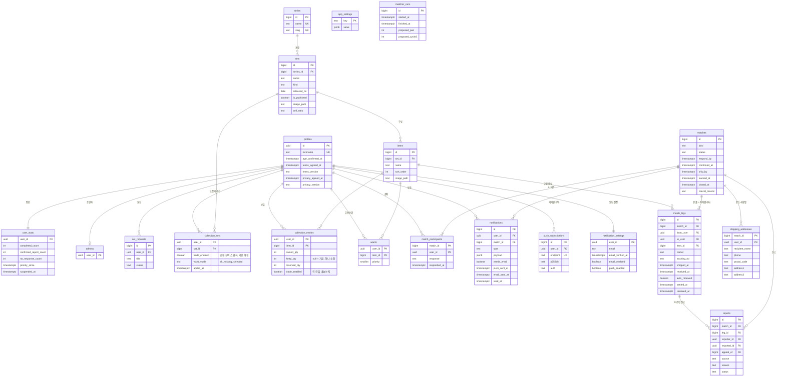

# ERD

컬럼과 제약의 설명은 [../architecture.md](../architecture.md) 3장 참고. 사용자 id 만 uuid, 나머지 PK 는 bigint identity.

뷰 (테이블 아님): `tradable_haves`(양), `wanted_items`(구), `matchable_users`(매칭 가능 사용자와 cycle3 자격).
`match_legs.from_user`, `to_user`, `reports.reporter_id`, `reported_id` 는 모두 `profiles.id` 를 가리킨다.
