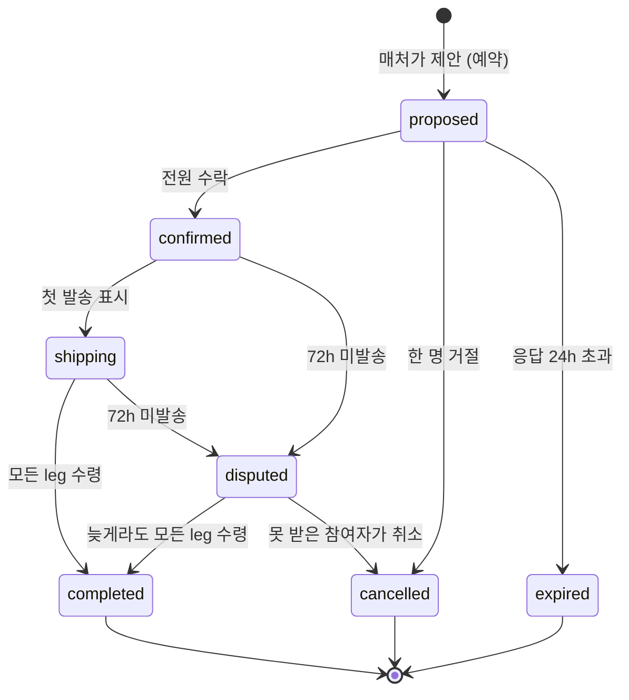

# 교환 상태머신

`matches.status` 의 전이. 모든 전이는 DB 함수 안에서만 일어난다 ([../architecture.md](../architecture.md) 3.7).
기한(응답 24h / 발송 경고 48h / 분쟁 72h / 자동 수령 7일 / 보관 30일)은 `app_settings` 의 기본값이다.

## 전이 표

| 현재 | 사건 | 다음 | 누가 | 부수 효과 |
|---|---|---|---|---|
| — | 매처가 후보 제안 | `proposed` | 매처 | 보내는 아이템 `reserved_qty + 1`, 참여자 알림 |
| `proposed` | 전원 수락 | `confirmed` | 참여자 | `ship_by` 설정, 보내는 사람에게 배송 정보 공개 |
| `proposed` | 한 명 거절 | `cancelled` | 참여자 | 예약 해제, 배송 정보 즉시 삭제 |
| `proposed` | 응답 기한 초과 | `expired` | pg_cron | 예약 해제, 배송 정보 즉시 삭제, 무응답자 `no_response_count + 1`, 나머지 `priority_since` 설정 |
| `confirmed` | 첫 발송 표시 | `shipping` | 보내는 사람 | 받는 사람 알림 |
| `confirmed` / `shipping` | 48h 미발송 | (그대로) | pg_cron | 보내지 않은 사람에게 경고 알림 1회 |
| `confirmed` / `shipping` | 72h 미발송 | `disputed` | pg_cron | 전원 알림, 못 받은 사람에게 취소 선택지 |
| `shipping` / `disputed` | 모든 leg 수령 | `completed` | 받는 사람 | 도감 수량 이동(단일 트랜잭션), `completed_count + 1` |
| `shipping` / `disputed` | 발송 후 7일, 수령 확인·미수령 신고 없음 | (leg 수령 처리) | pg_cron | 자동 수령. 이로써 모든 leg 가 수령되면 `completed` |
| `disputed` | 취소 선택 | `cancelled` | 못 받은 참여자 | leg 별 처리 (아래), 피해자에게 재매칭 우선권 + 못 받은 아이템 구 최상위 |
| `cancelled` | 발송됐던 leg 의 수령 확인 또는 자동 수령 | (그대로) | 받는 사람 / pg_cron | 그 leg 만 도감 반영 |
| `completed` / `cancelled` | 종료 후 30일, 반영 안 된 발송 leg 없음 | (그대로) | pg_cron | 배송 정보·송장 정보 삭제 |

## 분쟁 후 취소 시 leg 처리

| 취소 시점의 leg | 처리 | 예약 |
|---|---|---|
| 수령 확인됨 | 즉시 도감 반영 (`settled_at`) | 반영과 함께 −1 |
| 발송했지만 수령 확인 전 | 그대로 둔다. 수령 확인 또는 자동 수령(7일) 때 도감 반영 | **유지** |
| 미발송 | 해제 (`released_at`) | −1 |

- 피해자 = 자기 leg 는 발송했는데 받을 leg 는 미발송인 참여자.
- `cancelled` 는 매칭의 종료 상태지만, 발송된 leg 는 수령 확인까지 살아 있다. leg 의 끝은 `settled_at` 또는 `released_at` 이다.

## 불법 전이 (함수가 거부해야 한다)

- 종료 상태(`completed`, `cancelled`, `expired`)에서 다른 상태로
- `cancelled` 매칭에서 발송된 적 없는 leg 의 발송·수령 표시
- 이미 반영되거나 해제된 leg 의 재처리
- `proposed` 에서 발송·수령 표시
- 참여자가 아닌 사용자의 수락·거절
- leg 의 보내는 사람이 아닌 사용자의 발송 표시, 받는 사람이 아닌 사용자의 수령 표시
- 발송 표시 전의 수령 표시
- 이미 응답한 참여자의 재응답
- `disputed` 가 아닌 상태에서 `cancel_disputed_match`, 또는 받을 물건을 모두 받은 참여자의 취소

## 예약 수량 규칙

- `reserved_qty` 는 `proposed` 진입 시 leg 마다 +1.
- leg 가 도감에 반영될 때(`settled_at`) `owned_qty` 와 함께 −1, 해제될 때(`released_at`) −1. 한 leg 에서 둘 중 하나만, 한 번만 일어난다.
- `proposed` 에서 `cancelled` / `expired` 로 가면 모든 leg 가 해제된다. `completed` 로 가면 모든 leg 가 반영된다. `disputed → cancelled` 만 leg 별로 갈린다.
- 어느 시점에도 `owned_qty − 실제 소장 − reserved_qty ≥ 0` (실제 소장 = `coalesce(keep_qty, least(owned_qty, 1))`, architecture.md 3.3).

## 신고와의 관계

신고(`reports`)는 매칭 상태를 바꾸지 않는다. 성사된 매칭(`confirmed` 이후)의 참여자가 접수하고, 운영자가 확인하면 `confirmed_report_count + 1` → 1회 cycle3 불가, 2회 매칭 정지.

- 미수령 신고가 접수된 leg 는 자동 수령하지 않는다. 운영자가 확인하면 그 leg 를 해제하고, 기각하면 수령 처리한다.
- 분쟁 후 취소에서는 72시간 넘게 발송 표시가 없던 leg 의 보내는 사람에게 미발송이 **자동으로 +1** 된다 (시스템이 확인된 신고를 기록). 그 외 신고는 운영자가 확인한 것만 센다.
- 자동 +1 을 받은 당사자는 이의를 제기할 수 있고, 운영자는 이의 제기 없이도 정정할 수 있다. 받아들여지면 횟수 −1, 정지 여부 재계산.
